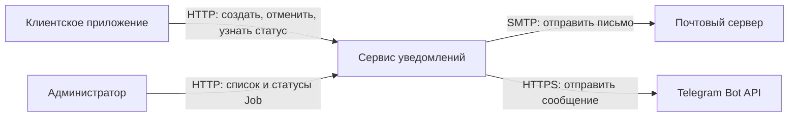
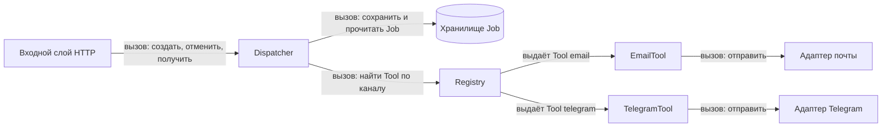
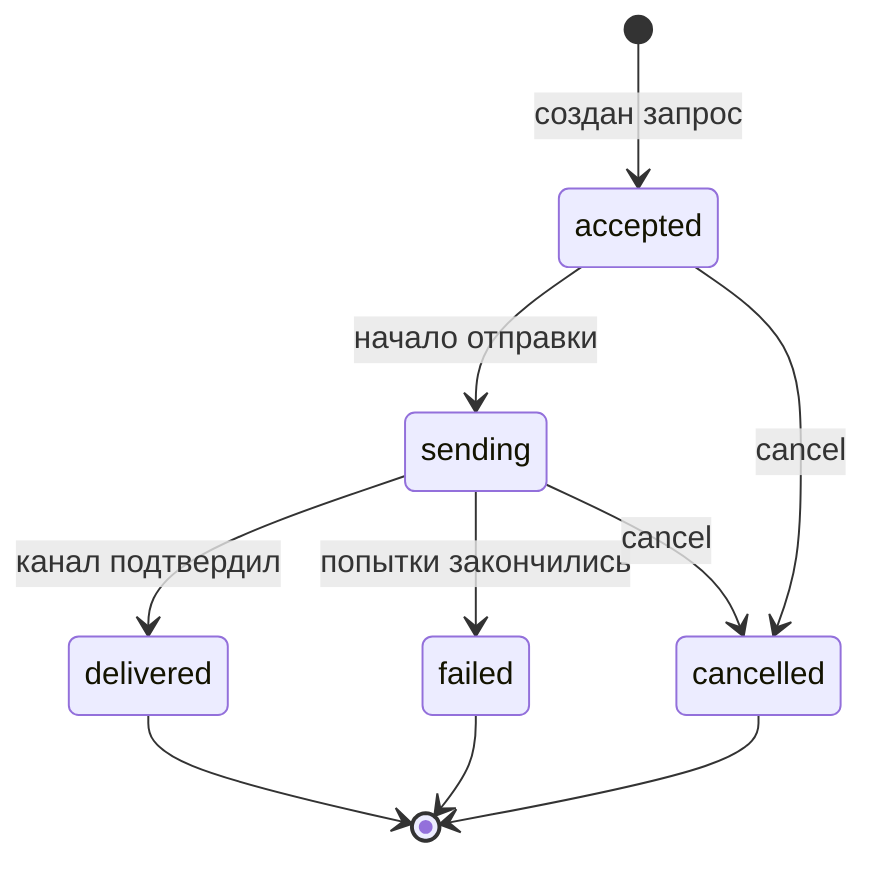

# Архитектура

## 1. Контекст системы

Что показывают стрелки: **вызовы** во время работы, то есть кто к кому обращается
и по какому протоколу. Стрелка идёт от вызывающего к вызываемому.

## 2. Компоненты

Что показывают стрелки: **вызовы** (кто кого вызывает при обработке запроса), а не
зависимости кода. По коду Dispatcher зависит только от интерфейса Tool и Registry,
конкретные Tool и адаптеры он не знает (лекция 103).

| Компонент | За что отвечает | Что скрывает от соседей |
|---|---|---|
| Входной слой HTTP | принимает запрос, проверяет формат, формирует ответ и код ошибки | устройство Dispatcher и хранилища |
| Dispatcher | создаёт Job, ведёт жизненный цикл, повторы, отмена | как именно доставляется сообщение |
| Registry | по имени канала находит нужный Tool | список и устройство Tool |
| EmailTool | проверяет адрес и текст, отправляет письмо | протокол SMTP и формат писем |
| TelegramTool | проверяет chat_id и текст, отправляет в Telegram | формат API Telegram |
| Хранилище Job | сохраняет Job и статусы | СУБД и схему таблиц |
| Адаптер почты и Telegram | вызывает внешний сервис с timeout и retry, проверяет схему ответа | библиотеку и формат API сервиса |

## 3. Диаграмма состояний Job

Состояния: accepted (принято), sending (отправляется), delivered (доставлено),
failed (не доставлено), cancelled (отменено). Из delivered, failed и cancelled
выхода нет.

### Запрещённые переходы

| Переход | Что отвечает система |
|---|---|
| delivered → sending, failed → sending, cancelled → sending | 409, код `invalid_transition`, статус не меняется |
| delivered → cancelled, failed → cancelled | 409, код `invalid_transition`, статус не меняется |
| cancelled → delivered (запоздалое подтверждение провайдера) | подтверждение игнорируется, Job остаётся cancelled |
| accepted → delivered (минуя sending) | переход невозможен, статус меняет только Dispatcher |
